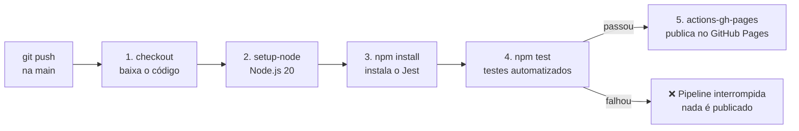

# ⚔️ Initiative Tracker

[](https://github.com/GMaruccio/INITIATIVE_TRACKER/actions/workflows/pipelines.yml)

Aplicação web simples para controlar a **ordem de iniciativa** em combates de RPG de mesa (ex.: D&D). O mestre cadastra os combatentes com nome, iniciativa, CA (Classe de Armadura) e HP, e a lista é ordenada automaticamente do maior para o menor valor de iniciativa.

🔗 **Aplicação publicada:** https://gmaruccio.github.io/INITIATIVE_TRACKER/

Este projeto foi desenvolvido como atividade prática de **automação com GitHub Actions**: uma pipeline de CI/CD que baixa o código, prepara o ambiente, executa testes automatizados e publica a aplicação no GitHub Pages, tudo a cada `push` na branch `main`.

---

## 📑 Sumário

- [Sobre a aplicação](#-sobre-a-aplicação)
- [Tecnologias](#-tecnologias)
- [Estrutura do projeto](#-estrutura-do-projeto)
- [Pipeline de CI/CD](#-pipeline-de-cicd)
- [Actions utilizadas](#-actions-utilizadas)
- [Como cada Action contribuiu para a automação](#-como-cada-action-contribuiu-para-a-automação)
- [Execução e verificação da pipeline](#-execução-e-verificação-da-pipeline)
- [Como executar localmente](#-como-executar-localmente)
- [Como configurar o GitHub Pages](#-como-configurar-o-github-pages)
- [Integrantes](#-integrantes)

---

## 🎲 Sobre a aplicação

Funcionalidades:

- Adicionar combatentes com **nome**, **iniciativa**, **CA** e **HP** (nome e iniciativa são obrigatórios);
- Ordenação automática por iniciativa (maior → menor);
- Remoção de combatentes da lista;
- Interface escura, responsiva e sem dependências externas em tempo de execução.

A regra de negócio principal é a função `ordenarCombatentes(lista)` em `script.js`, que retorna uma **nova** lista ordenada sem alterar a original. É essa função que é validada pelo teste automatizado executado na pipeline.

## 🛠 Tecnologias

| Camada | Tecnologia |
| --- | --- |
| Front-end | HTML5, CSS3 e JavaScript puro |
| Testes | [Jest](https://jestjs.io/) 29 |
| Ambiente de execução | Node.js 20 (somente para os testes) |
| CI/CD | GitHub Actions |
| Hospedagem | GitHub Pages |

## 📁 Estrutura do projeto

```
INITIATIVE_TRACKER/
├── .github/
│   └── workflows/
│       └── pipelines.yml    # Definição da pipeline de CI/CD
├── index.html               # Estrutura da página
├── style.css                # Estilos
├── script.js                # Lógica da aplicação
├── script.test.js           # Teste automatizado (Jest)
├── package.json             # Dependências e script de teste
└── README.md                # Este arquivo
```

## 🔄 Pipeline de CI/CD

O workflow está em [`.github/workflows/pipelines.yml`](.github/workflows/pipelines.yml) e é disparado a cada `push` na branch `main`.



### Arquivo do workflow

```yaml
name: CI/CD Initiative Tracker

on:
  push:
    branches:
      - main

jobs:
  build-test-deploy:
    runs-on: ubuntu-latest
    permissions:
      contents: write

    steps:
      - name: 1. Baixar o Código (Action 1)
        uses: actions/checkout@v4

      - name: 2. Configurar o Ambiente Node.js (Action 2)
        uses: actions/setup-node@v4
        with:
          node-version: '20'

      - name: 3. Instalar dependências dos testes
        run: npm install

      - name: 4. Executar Testes Automatizados (CI)
        run: npm test

      - name: 5. Publicar no GitHub Pages (Action 3)
        uses: peaceiris/actions-gh-pages@v4
        with:
          github_token: ${{ secrets.GITHUB_TOKEN }}
          publish_dir: ./
```

> **Observação:** as etapas 3 e 4 usam comandos de terminal (`run`), e não Actions do Marketplace. Elas fazem a ligação entre as Actions 2 e 3: instalam o Jest e executam os testes que decidem se o deploy pode acontecer.

## 🧩 Actions utilizadas

Foram escolhidas **3 Actions do GitHub Marketplace**, cada uma aplicada em uma etapa diferente do processo.

| # | Action | Versão | Etapa da pipeline | Função |
| --- | --- | --- | --- | --- |
| 1 | [`actions/checkout`](https://github.com/marketplace/actions/checkout) | `v4` | Preparação (etapa 1) | Baixa o código do repositório para dentro da máquina virtual do runner |
| 2 | [`actions/setup-node`](https://github.com/marketplace/actions/setup-node-js-environment) | `v4` | Configuração do ambiente (etapa 2) | Instala e configura o Node.js 20 e o `npm` no runner |
| 3 | [`peaceiris/actions-gh-pages`](https://github.com/marketplace/actions/github-pages-action) | `v4` | Deploy (etapa 5) | Publica os arquivos do projeto na branch `gh-pages`, que o GitHub Pages serve como site |

### 1️⃣ `actions/checkout@v4`

- **O que faz:** clona o repositório no runner (`ubuntu-latest`). Sem ela, a máquina virtual começa vazia e não existe código para testar ou publicar.
- **Onde foi aplicada:** primeira etapa, pois todas as seguintes dependem dos arquivos do projeto.
- **Configuração:** nenhuma configuração extra; o comportamento padrão (baixar o commit que disparou o workflow) atende ao projeto.

### 2️⃣ `actions/setup-node@v4`

- **O que faz:** instala uma versão específica do Node.js e do `npm` no runner.
- **Onde foi aplicada:** logo após o checkout e antes da instalação das dependências, pois `npm install` e `npm test` precisam do Node.
- **Configuração:** `node-version: '20'`, que fixa a versão do Node e garante que os testes rodem sempre no mesmo ambiente, independentemente do que vem pré-instalado na imagem do runner.

### 3️⃣ `peaceiris/actions-gh-pages@v4`

- **O que faz:** envia o conteúdo de um diretório para a branch `gh-pages` do repositório, fazendo o deploy no GitHub Pages sem nenhum passo manual.
- **Onde foi aplicada:** última etapa, executada **somente se todas as anteriores (incluindo os testes) passarem**.
- **Configuração:**
  - `github_token: ${{ secrets.GITHUB_TOKEN }}`: token gerado automaticamente pelo GitHub a cada execução, sem necessidade de criar segredos manualmente;
  - `publish_dir: ./`: publica a raiz do projeto;
  - `permissions: contents: write` no job, para permitir o `push` na branch `gh-pages`.

## 🚀 Como cada Action contribuiu para a automação

| Antes (processo manual) | Depois (com a pipeline) | Action responsável |
| --- | --- | --- |
| Clonar o repositório e atualizar a cópia local | O runner recebe automaticamente o código mais recente a cada push | `actions/checkout` |
| Instalar o Node.js na versão correta em cada máquina | Ambiente padronizado e reproduzível em toda execução | `actions/setup-node` |
| Rodar os testes manualmente (e lembrar de rodar) | Testes executados automaticamente a cada push | `npm test` (Jest) |
| Copiar arquivos e fazer o deploy à mão | Publicação automática no GitHub Pages | `peaceiris/actions-gh-pages` |

Resultado: o fluxo **commit → teste → publicação** acontece sem intervenção humana, e o **teste funciona como um "portão de qualidade"**: se `ordenarCombatentes` quebrar, a etapa 4 falha, a pipeline é interrompida e a versão com defeito **não** chega ao site publicado.

## ✅ Execução e verificação da pipeline

Verificação de cada etapa:

| Etapa | Como verificar | Resultado esperado |
| --- | --- | --- |
| 1. Checkout | Aba **Actions** → execução → etapa 1 | ✅ Código baixado |
| 2. Setup Node | Etapa 2 | ✅ Node v20 instalado |
| 3. Instalar dependências | Etapa 3 | ✅ Jest instalado |
| 4. Testes | Etapa 4 | ✅ `1 passed, 1 total` |
| 5. Deploy | Etapa 5 + branch `gh-pages` | ✅ Novo commit `deploy: <sha>` na `gh-pages` e site atualizado |

Saída esperada da etapa 4:

```
PASS ./script.test.js
  ✓ Deve ordenar os combatentes do maior para o menor valor de iniciativa

Test Suites: 1 passed, 1 total
Tests:       1 passed, 1 total
```

### Evidências

> 📸 **Inserir aqui os prints da execução** (aba Actions do repositório) e do site publicado. Sugestão de arquivos em uma pasta `docs/`:
>
> ```markdown
> 
> 
> 
> ```

O histórico do repositório também comprova a execução: a branch `gh-pages` contém commits `deploy: <sha>` criados automaticamente pela Action `peaceiris/actions-gh-pages`.

## 💻 Como executar localmente

Pré-requisito: [Node.js](https://nodejs.org/) 20 ou superior.

```bash
# 1. Clonar o repositório
git clone https://github.com/GMaruccio/INITIATIVE_TRACKER.git
cd INITIATIVE_TRACKER

# 2. Instalar as dependências
npm install

# 3. Rodar os testes
npm test
```

Para usar a aplicação, basta abrir o arquivo `index.html` no navegador.

## 🌐 Como configurar o GitHub Pages

1. Faça o primeiro `push` na `main` para que a pipeline crie a branch `gh-pages`;
2. No repositório, acesse **Settings → Pages**;
3. Em **Source**, selecione **Deploy from a branch**;
4. Escolha a branch **`gh-pages`** e a pasta **`/ (root)`**;
5. Salve. O site ficará disponível em `https://<usuario>.github.io/INITIATIVE_TRACKER/`.

Também é necessário que o workflow tenha permissão de escrita: **Settings → Actions → General → Workflow permissions → Read and write permissions** (o workflow já declara `permissions: contents: write`).

## 👥 Integrantes

- GMaruccio (Giovanni Camargo Maruccio)
- _(adicionar os demais integrantes do grupo)_

---

📚 **Disciplina / Atividade:** _(preencher)_
